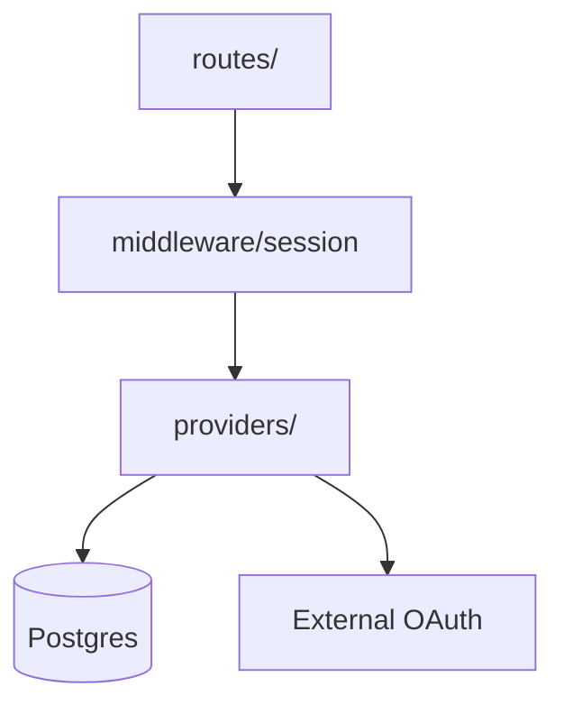

# Diagram Standards

Shared rules for diagrams in `$explain` reports. Every lens subagent reads this file before it draws a diagram, and the orchestrator follows it in the synthesis.

**All graphs MUST use Mermaid syntax.** ASCII box-drawing is not permitted. The HTML renderer turns Mermaid blocks into SVG, and Mermaid source stays readable in raw markdown.

## Diagram Type per Section

| Section | Diagram | Mermaid syntax |
|---|---|---|
| Architecture Overview (top-level) | Layered dependency graph | `graph TD` |
| Structure & Entry Points | Module dependency graph | `graph LR` |
| Behavior — Key Workflows | Call chain / flow | `sequenceDiagram` for linear request/response; `graph LR` when branching and error paths dominate |
| Domain & Data | State transitions (optional) | `stateDiagram-v2` |
| External Dependencies | Integration map | `graph TD` with the system as the central node |

Example:

````markdown

````

## Size Caps

Scale diagrams to the scope size.

| Source files in scope | Top-level overview | Inline diagrams |
|---|---|---|
| < 20 files | All modules, entry points, and data stores | Full detail per section |
| 20–100 files | Major modules + key entry points (up to ~12 nodes) | Moderate detail |
| 100–500 files | High-level layers/modules only (up to ~8 nodes) | Key paths only |
| 500+ files | Top-level architectural layers (~5 nodes) | Abbreviated |

If a diagram would go past these caps, group related modules into one node or use prose instead.

## Authoring Notes

- **Node labels**: use the `Id[label]` form (`Middleware[middleware/session]`) so the SVG shows a readable label and the source stays searchable.
- **Keep syntax simple**: one stray character breaks Mermaid rendering (the block then shows as plain code). Prefer simple syntax over clever features.
- **No styling**: skip `classDef` and `style`. They add size, not meaning.
